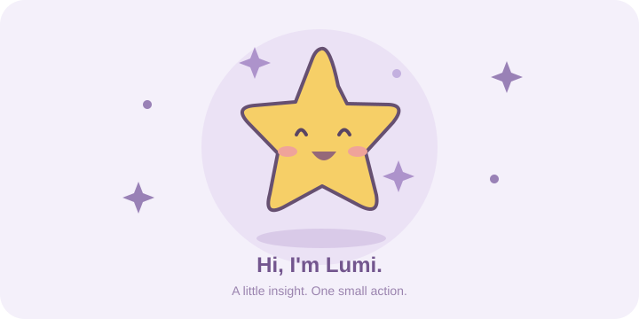

# Explore Your Little Universe

### A fresh perspective on today's little dilemmas.

[한국어](README.md) | **English**

## [Open the playground — no installation](https://ai-agent-orchestrator.github.io/explore-your-little-universe/)

Meet Lumi, try a daily dilemma, and inspect the knowledge graph and source evidence. Use a current Chrome/Edge browser with WebGPU; the first actual search downloads an embedding model.



**An MBTI & Astrology Daily Action Playground**

**Serverless · Google LiteRT-LM · On-device search**

Meet **Lumi**, a little star companion. Explore everyday dilemmas, discover connected perspectives, and try one small action. MBTI and astrology are playful fictional settings here, not validated predictions or clinical assessments.

## Static React + browser LiteRT-LM search

The React edition lives on the [`feat/serverless-react-litert-rag` branch](https://github.com/ai-agent-orchestrator/explore-your-little-universe/tree/feat/serverless-react-litert-rag).

No Spring server, Python web server, Ollama, database credentials, or paid API is required to run the page. Neo4j is used to build and inspect the graph. The published page reads an exported public snapshot and performs embedding, cosine search, and graph traversal on the visitor's device.

```text
Authoring: original scenario texts → LiteRT-LM embeddings → Neo4j → public snapshot
Browsing: React → on-device question embedding → vector search → graph expansion
```

### Run locally

Use Node.js 22.12+ and a recent Chrome or Edge browser with WebGPU enabled.

```powershell
git fetch origin
git switch feat/serverless-react-litert-rag
cd frontend
npm ci
npm run dev
```

Open the printed address, normally http://127.0.0.1:5173. An explicitly marked example appears immediately. The first real search downloads a pinned public model (~165MB), verifies its SHA-256, and runs it locally. Model caching depends on browser storage availability; startup depends on device memory and WebGPU support.

### Explore

- **60 original scenario cards:** appointments, messages, work, rest, travel, choices, personal pace, family and relationships, creativity, and boundaries.
- **24 small action suggestions**, each linked to supporting source cards.
- **16 MBTI Lumi outfits** and **12 zodiac Lumi palettes and symbols**.
- **Vector only:** the three most similar scenario texts.
- **Vector + graph:** additional evidence and suggestions reached from those same texts.
- **Evidence view:** source IDs, original text, graph paths, and a Cypher query to inspect the corresponding nodes in Neo4j.
- **Gemini prompt:** copy a source-grounded prompt yourself. Nothing is automatically sent to Gemini.

The browser does not contact Neo4j at runtime. Changes in the authoring DB require re-exporting the snapshot and rebuilding the page. Questions are neither sent to an application server nor stored. Model downloads contact the public model host.

### Build for static hosting

```powershell
cd frontend
npm ci
npm test
npm run build
```

Publish `frontend/dist` on a static host. Relative paths support GitHub Pages project URLs. No `.env` file should be included. Hosting and bandwidth free tiers depend on the provider.

[Full setup, architecture and weekend checks](https://github.com/ai-agent-orchestrator/explore-your-little-universe/blob/feat/serverless-react-litert-rag/docs/STATIC_REACT_RAG.md) · [Scenario corpus](https://github.com/ai-agent-orchestrator/explore-your-little-universe/blob/feat/serverless-react-litert-rag/mbti_lab/scenarios.py) · [Neo4j seed/export code](https://github.com/ai-agent-orchestrator/explore-your-little-universe/blob/feat/serverless-react-litert-rag/mbti_lab/rag_seed.py)

## Neo4j lab — MBTI + 12 zodiac signs

The original graph lab remains available:

- [12 zodiac signs + MBTI graph](docs/ASTROLOGY_LAB.md)
- [Original MBTI web lab](mbti_lab/README.md)
- [Three-database collaboration plan](docs/THREE_DB_COLLAB_PLAN.md)

Use Python 3.12 and a dedicated local Neo4j database named `mbti-zodiac`. See [database separation](docs/DATABASE_SEPARATION.md) and the Korean README for setup. Connection settings stay in local, ignored files.

```cypher
MATCH p = (:MbtiType {code:'INTJ'})-[:HAS_TRAIT]->(:SharedTrait)
          <-[:HAS_TRAIT]-(:ZodiacSign {name:'물병자리'})
RETURN p;
```

The fictional content supports graph-learning and entertainment. It is not an official MBTI test, astrology forecast, compatibility score, diagnosis, or treatment recommendation.
